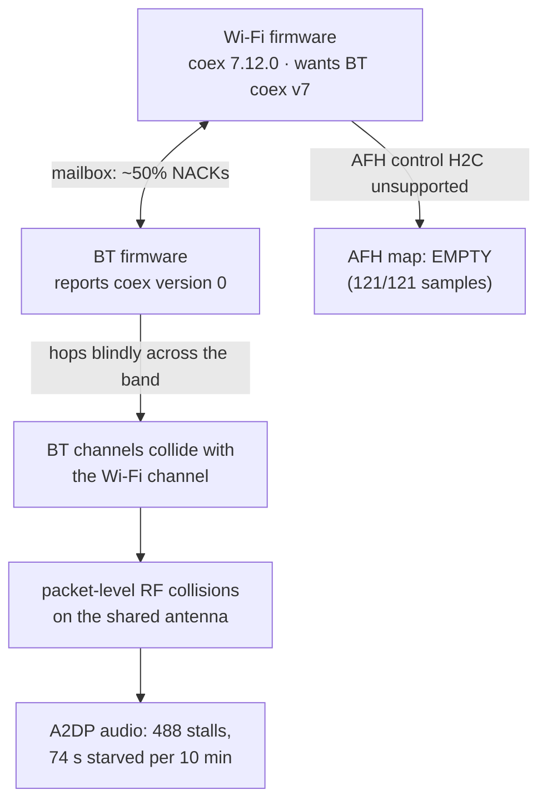

# RTL8852CE Bluetooth/Wi-Fi Coexistence Toolkit for Linux


**Bluetooth audio stuttering the moment 2.4 GHz Wi-Fi carries traffic — on a
Realtek RTL8852CE laptop?** This repository explains *why* it happens, proves
it with telemetry from the card's own coexistence engine, and ships the tools
that fix, measure, and repair it.

> **The one-sentence diagnosis:** on Linux, the two firmware halves of the
> RTL8852CE never complete their coexistence handshake (BT reports coex
> version **0**, the Wi-Fi side requires **7**), so adaptive frequency hopping
> never engages and Bluetooth hops straight through the Wi-Fi channel —
> packet-level RF collisions that no amount of time-slot tuning can fix.

---

## Is your laptop affected?

You have an **RTL8852CE** combo card (also check RTL8852B / 8851B — same
family) and:

- Bluetooth audio (A2DP) stutters or skips **only while 2.4 GHz Wi-Fi is busy**
- Moving the router or phone closer/farther doesn't fully fix it
- Every power-save tweak and driver reinstall changed nothing
- Windows on the same hardware played the same audio clean

The 30-second confirmation is one command after the instrumented driver is
loaded: `sudo cat /sys/kernel/debug/rtw89/btc_info` — if you see
`BT_FW_coex:0` and an empty `afh_map`, you have the same gap this repository
documents. Post your dump (see [Contributing](CONTRIBUTING.md)) — each one
maps the gap on another hardware variant.

## Results at a glance

| Metric (600 s A2DP playback, 37,149 packets) | Value |
|---|---:|
| Audio delivery stalls > 50 ms | **488** |
| Accumulated silence | **74 s (12.3% of wall time)** |
| Worst single gap | 541 ms |
| Wi-Fi→BT AFH map during entire capture | **empty** |
| Coexistence mailbox messages rejected | **~50%** (41,154 NACKs) |
| HCI-level anomalies (disconnects, errors) | 0 |

And the experiment that pinned the mechanism down:

| Coex scheme (50 s each) | stalls/s | starved | worst gap |
|---|---:|---:|---:|
| Default (auto) | 1.68 | 7.0 s | 283 ms |
| BT-exclusive (`OFF_BT`) — *no airtime competition at all* | **3.18** ✗ | 15.6 s | 366 ms |
| PS-TDMA variant | **1.28** ✓ | 4.3 s | 128 ms |

Giving Bluetooth the radio *exclusively* made stutter **worse** — proof that
the loss is RF-level packet collision, not airtime starvation. Full data:
[`docs/MEASUREMENTS.md`](docs/MEASUREMENTS.md).

## How the failure chain works



Windows never sees this because Realtek ships matched proprietary driver
halves there. On Linux the halves are open-source driver + published firmware,
and the coordination handshake simply doesn't complete — **for every
RTL8852CE owner**. That makes this a genuine driver/firmware coordination gap,
not one broken laptop.

## What's in the box

| Path | Contents |
|---|---|
| `patches/` | Two verified patches for the vanilla `rtw89` driver (7.0.13): **0001** enables the coexistence debugfs telemetry on kernels without `CONFIG_CFG80211_DEBUGFS` (liquorix et al.); **0002** adds live coex-policy tuning knobs (`/sys/module/rtw89_core/parameters/btc_policy_override`, `btc_w1_dur_ms`) |
| `scripts/` | The full toolkit: verified module swap with auto-rollback, 10-minute correlated capture harness (HCI + traffic + coex state), policy A/B tester, **direct-AFH HCI workaround**, and a Bluetooth speaker repair kit |
| `docs/` | [`ROOT-CAUSE.md`](docs/ROOT-CAUSE.md) · [`MEASUREMENTS.md`](docs/MEASUREMENTS.md) · [`USAGE.md`](docs/USAGE.md) |
| `data/` | Raw telemetry: 121 coex-state snapshots, traffic log, stall tables |

**Reproducibility guarantee:** applying the two patches to pristine 7.0.13
sources produces files **byte-identical** to the instrumented driver the
author ran for every measurement in this repository.

## Quick start

<details open>
<summary><b>1 — Build the instrumented driver</b> (out-of-tree, no reboot)</summary>

```bash
# Match your running kernel's source version
KVER=$(uname -r | cut -d- -f1)          # e.g. 7.0.13
wget "https://cdn.kernel.org/pub/linux/kernel/v7.x/linux-${KVER}.tar.xz"
tar -xf "linux-${KVER}.tar.xz"
cd "linux-${KVER}"

# Apply the patches — from the KERNEL ROOT
patch -p1 < /path/to/rtl8852ce-bt-coex/patches/0001-*.patch
patch -p1 < /path/to/rtl8852ce-bt-coex/patches/0002-*.patch

# Build out-of-tree with debugfs + debug enabled
cd drivers/net/wireless/realtek/rtw89
cp /path/to/rtl8852ce-bt-coex/patches/Makefile .
make -C /lib/modules/"$(uname -r)"/build M="$PWD" modules
```

</details>

<details>
<summary><b>2 — Swap it in</b> (10 s Wi-Fi blip, auto-rollback, Bluetooth untouched)</summary>

```bash
sudo bash scripts/swap-modules.sh
```

The script moves the stock modules aside (never deletes), explicitly unloads
**all four** rtw89 modules (a plain `modprobe -r` silently leaves the stock
core loaded — see [`docs/USAGE.md`](docs/USAGE.md)), verifies each loaded
module's identity via sysfs, and rolls everything back automatically if any
step fails — even if your session dies mid-swap.

</details>

<details>
<summary><b>3 — Read the card's mind</b></summary>

```bash
sudo cat /sys/kernel/debug/rtw89/btc_info
```

Coex protocol versions, BT link state, TDMA slot tables, AFH map, mailbox
statistics — everything this investigation was built on.

</details>

<details>
<summary><b>4 — Reproduce the experiments</b></summary>

```bash
sudo bash scripts/btc-policy-test.sh   # 5-policy A/B, per-phase stall counts
sudo bash scripts/afh-test2.sh         # direct-AFH mask A/B (music playing!)
```
`afh-test2.sh` computes the BT channel mask from your **live** Wi-Fi
frequency, programs it with the standard HCI command
`Set AFH Host Channel Classification` (OGF 0x03 / OCF 0x003F), verifies the
stream is up, and captures 45 s masked vs 45 s unmasked.

</details>

## The AFH workaround in one picture

The Wi-Fi firmware is supposed to hand the BT side a "avoid these channels"
map through the vendor mailbox — a path that is dead on Linux. But AFH
classification is also a **standard Bluetooth HCI command**, so the host can
deliver the same message itself:

```
Wi-Fi on channel 9  (2432–2452 MHz)  →  forbid BT channels 30–50
Wi-Fi on channel 11 (2452–2472 MHz)  →  forbid BT channels 50–70

hcitool cmd 0x03 0x003F <10-byte channel bitmask>
```

`scripts/afh-test2.sh` does this automatically from your live frequency.
**Status:** demonstrated end-to-end; stress-validation under sustained Wi-Fi
load is the remaining step before it becomes the default behavior (see
roadmap).

## FAQ

<details>
<summary><b>Will this fix my stutter?</b></summary>
The root cause characterization is complete and reproduced; the policy knobs
give a measurable ~24% improvement today, and the AFH workaround targets the
dominant mechanism. The final stress-load validation is in progress — check
the roadmap. Meanwhile, the capture harness tells you objectively what *your*
bottleneck is.
</details>

<details>
<summary><b>My laptop doesn't have the RTL8852CE. Anything here for me?</b></summary>
The methodology (debugfs coex telemetry, HCI-level AFH programming, stall
measurement from <code>btmon</code>) transfers to any Realtek combo card of
the 8852/8922 families and to any "BT dies when Wi-Fi works" investigation.
The patches are 8852C-specific.
</details>

<details>
<summary><b>Why does Windows not have this problem?</b></summary>
Realtek's Windows Wi-Fi and BT drivers are matched proprietary halves that
complete the coexistence handshake. On Linux the halves are the open driver +
published firmware, and the handshake reports version 0 vs the required 7.
This repo documents that gap with card-level evidence rather than anecdotes.
</details>

<details>
<summary><b>Firmware blobs?</b></summary>
Never distributed here. Patches and tools only; firmware comes from your
distro's <code>linux-firmware</code> package (BT side:
<code>rtl_bt/rtl8852cu_fw_v2</code>, verified identical to upstream HEAD).
</details>

<details>
<summary><b>Which kernels/hardware?</b></summary>
Developed on Ubuntu 24.04 + liquorix 7.0.13, ASUS TUF Gaming F16 (FX608JHR,
Foxconn RTL8852CE, BT USB ID 0489:e122). Patches are source-level and should
apply to nearby kernel versions; the coex findings apply to the whole
RTL8852C family.
</details>

## Roadmap

- [x] Instrumented driver pipeline (patch → build → verified module swap)
- [x] Correlated capture harness (HCI ∥ traffic ∥ coex state)
- [x] Root-cause characterization (121-sample telemetry)
- [x] Coex policy A/B (5 schemes, objective stall counts)
- [x] Direct-AFH HCI workaround demonstrated
- [ ] **Stress-load validation** of the AFH mask (heavy download during A/B)
- [ ] **Persistent AFH programming** on channel change / reconnect
- [ ] Upstream submission to linux-wireless

## Contributing

Issue reports with a `btc_info` dump (after building patch 0001) are gold —
they map the handshake gap across hardware variants. See
[`CONTRIBUTING.md`](CONTRIBUTING.md).

## Crediting this work

If this repository helps your research, debugging, or a patch of your own,
a link back or a citation (see [`CITATION.cff`](CITATION.cff), rendered by
GitHub's "Cite this repository" button) is appreciated.

## Author

**Hamza Gouda** — investigation, hardware experiments, measurements, and
tooling. Every number in these docs is reproducible from the scripts and raw
telemetry in [`data/`](data/).

If this repository diagnosed or fixed your laptop, please **star it** and
share your `btc_info` dump — that telemetry is what turns one laptop's fix
into every RTL8852CE owner's fix.

Licensed GPL-2.0 (matching the upstream driver) — see [`LICENSE`](LICENSE).
**No firmware blobs are or will ever be distributed here.**
