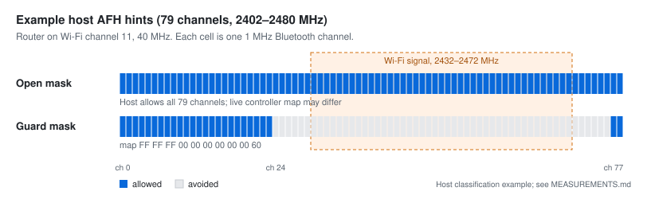
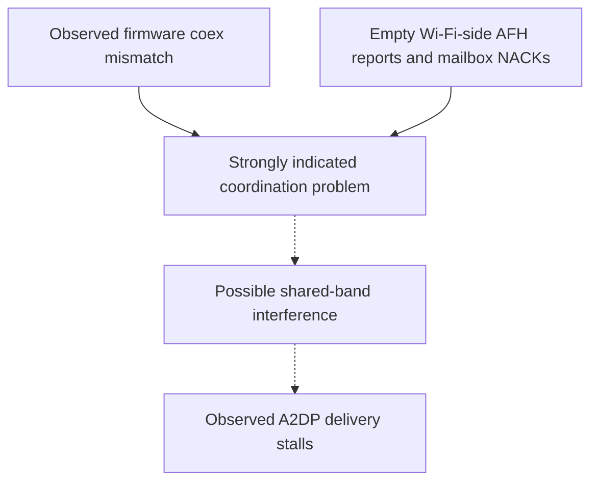

# RTL8852CE Coexistence Investigation and Single-Laptop Workaround


[](https://github.com/hamza-gouda1/rtl8852ce-bt-coex/actions/workflows/ci.yml)

**Bluetooth audio stuttering while 2.4 GHz Wi-Fi is busy on an RTL8852CE laptop?**
This repository documents a strongly indicated firmware coexistence problem,
measurements from one ASUS laptop, and an AFH/AAC workaround validated on that laptop.

The initial captures showed a firmware coexistence version mismatch, an empty
Wi-Fi-side AFH report, and frequent audio delivery stalls. These observations
strongly indicate a coordination problem. The workaround produced clean audio
in the recorded single-laptop validation with Wi-Fi as the only network link.

The later controlled SBC rerun could not isolate the workaround's effect.
Both host classifications resulted in live Bluetooth maps with zero measured
Wi-Fi overlap. Validation currently covers one laptop. A later guard-active capture on
the same laptop still recorded stalls with zero measured overlap. Read the [measurements and experimental
limits](docs/MEASUREMENTS.md#controlled-sbc-rerun-2026-11-08) alongside the
[workaround instructions](docs/SOLUTION.md).

<p align="center">
  
</p>

---

## Try the validated workaround

No kernel build, no driver swap, no reboot. It works with the stock `rtw89` driver.

```bash
git clone https://github.com/hamza-gouda1/rtl8852ce-bt-coex.git
cd rtl8852ce-bt-coex

# Optional but recommended: AAC codec for PipeWire (Debian/Ubuntu ship without it)
sudo apt install build-essential meson ninja-build pkg-config libfdk-aac-dev \
     libdbus-1-dev libsbc-dev libbluetooth-dev libglib2.0-dev libudev-dev
bash scripts/build-aac-plugin.sh

# Install the AFH guard service (+ the AAC plugin if you built it)
sudo bash scripts/install.sh
```

Then put the earbuds in their case, run `sudo systemctl restart bluetooth`,
and take them out again. Check it's working with
`journalctl -t bt-afh-guard`, or run `sudo bash scripts/bt-afh-guard --status`
for the Wi-Fi block, host mask and the live hop map of every connected link.
Remove everything with `sudo bash scripts/uninstall.sh`.

---

## Is your laptop affected?

You have an **RTL8852CE** combo card (also check RTL8852B / 8851B — same
family) and:

- Bluetooth audio (A2DP) stutters or skips **only while 2.4 GHz Wi-Fi is busy**
- Moving the router or phone closer/farther doesn't fully fix it
- Every power-save tweak and driver reinstall changed nothing
- Windows on the same hardware played the same audio clean

Read `sudo cat /sys/kernel/debug/rtw89/btc_info` once the instrumented
driver is loaded. `BT_FW_coex:0` and an empty `afh_map` match the Wi-Fi-side
reports from the reference laptop. An HCI read is needed to measure the live
Bluetooth link map. See [Contributing](CONTRIBUTING.md) for details on sharing
a capture.

## Results at a glance

| Metric (600 s A2DP playback, 37,149 packets) | Value |
|---|---:|
| Audio delivery stalls > 50 ms | **488** |
| Accumulated silence | **74 s (12.3% of wall time)** |
| Worst single gap | 541 ms |
| Wi-Fi→BT AFH map during entire capture | **empty** |
| Coexistence mailbox messages rejected | **~50%** (41,154 NACKs) |
| HCI-level anomalies (disconnects, errors) | 0 |

The initial policy comparison used five 50-second phases.

| Coex scheme (50 s each) | stalls/s | starved | worst gap |
|---|---:|---:|---:|
| Default (auto) | 1.68 | 7.0 s | 283 ms |
| BT-exclusive policy (`OFF_BT`) | **3.18** ✗ | 15.6 s | 366 ms |
| PS-TDMA variant | **1.28** ✓ | 4.3 s | 128 ms |

Selecting the BT-exclusive policy increased stalls, while the PS-TDMA variant
reduced them. This supports further investigation of coexistence, but the
policy comparison alone cannot establish RF collisions as the dominant cause.
Full data and the controlled rerun are in [MEASUREMENTS.md](docs/MEASUREMENTS.md).

## Indicated failure chain



The measurements cover one laptop. Independent reports are needed to determine
which other hardware and firmware combinations exhibit the same behavior.

## Known issues (reference laptop, 2026-11-20 boot)

- **Weak-signal beacon loss.** At −83 dBm / MCS 3 the link logged 144
  `CTRL-EVENT-BEACON-LOSS` and 10 disconnects (reason=4,
  `locally_generated=1`) in one boot, with `rtw89 ... timed out to flush
  queues` spikes. The largest burst (78 events in one hour) overlapped A2DP
  streaming — a single observation, not a correlation; the new
  [Wi-Fi health tooling](#whats-in-the-box) exists to measure it properly.
- **Bluetooth → Wi-Fi direction.** The repository documents Wi-Fi → Bluetooth
  damage; whether streaming audio degrades Wi-Fi is under investigation with
  `scripts/wifi-health-capture.sh` + `scripts/analyze-wifi-health.py`.
- **`[RX_DCK] S1 RXDCK timeout`** in the kernel log on boots where Bluetooth
  audio streams — the shared antenna disturbing the Wi-Fi RF calibration
  (see [SOLUTION.md §7](docs/SOLUTION.md#7-other-things-found-on-the-reference-laptop)).
- **Version drift.** The installed `/usr/local/sbin/bt-afh-guard` can lag the
  repo copy; `install.sh` now prints installed vs repo version before
  replacing, and the daemon reports itself via `--version`.

## What's in the box

| Path | Contents |
|---|---|
| `patches/` | Two verified patches for the vanilla `rtw89` driver (7.0.13): **0001** enables the coexistence debugfs telemetry on kernels without `CONFIG_CFG80211_DEBUGFS` (liquorix et al.); **0002** adds live coex-policy tuning knobs (`/sys/module/rtw89_core/parameters/btc_policy_override`, `btc_w1_dur_ms`) |
| `scripts/bt-afh-guard` + `scripts/hci-cmd.py` + `systemd/` | **The workaround (v1.1).** A hardened daemon that keeps the BT controller's AFH map in sync with the live Wi-Fi channel and width: every send is verified against the controller's Command Complete status, the live hop map is read back per link (`--status`), and a 30 s hold-down rides out Wi-Fi flaps. `hci-cmd.py` is a dependency-free verified HCI sender; `install.sh` warns on version drift |
| `tests/` | Dependency-free test suite for the mask logic, the verified sender (replaying recorded controller output) and the hold-down state machine, run in CI |
| `scripts/wifi-health-capture.sh` + `scripts/analyze-wifi-health.py` | Measure the Bluetooth → Wi-Fi direction: sample link health + A2DP state every 2 s, compare beacon loss / retries / disconnects while audio runs vs suspended |
| `scripts/afh-positive-control.sh` | Positive control for the causal claim: forces Wi-Fi overlap with the (invalid-as-workaround) confined mask to test whether overlap actually produces stalls |
| `scripts/` | The rest of the toolkit: verified module swap with auto-rollback, 10-minute correlated capture harness (HCI + traffic + coex state), policy A/B tester, direct-AFH A/B experiment, and a Bluetooth speaker repair kit |
| `scripts/build-aac-plugin.sh` | Builds PipeWire's AAC Bluetooth codec for your exact installed PipeWire version |
| `scripts/install.sh` / `uninstall.sh` | One-command install and removal of the workaround |
| `docs/` | [`SOLUTION.md`](docs/SOLUTION.md) · [`ROOT-CAUSE.md`](docs/ROOT-CAUSE.md) · [`MEASUREMENTS.md`](docs/MEASUREMENTS.md) · [`USAGE.md`](docs/USAGE.md) |
| `data/` | Raw telemetry: 121 coex-state snapshots, traffic log, stall tables |

**Reproducibility guarantee:** applying the two patches to pristine 7.0.13
sources produces files **byte-identical** to the instrumented driver the
author ran for every measurement in this repository.

## Quick start

<details open>
<summary><b>1 — Build the instrumented driver</b> (out-of-tree, no reboot)</summary>

```bash
# Match your running kernel's source version
KVER=$(uname -r | cut -d- -f1)          # e.g. 7.0.13
wget "https://cdn.kernel.org/pub/linux/kernel/v7.x/linux-${KVER}.tar.xz"
tar -xf "linux-${KVER}.tar.xz"
cd "linux-${KVER}"

# Apply the patches — from the KERNEL ROOT
patch -p1 < /path/to/rtl8852ce-bt-coex/patches/0001-*.patch
patch -p1 < /path/to/rtl8852ce-bt-coex/patches/0002-*.patch

# Build out-of-tree with debugfs + debug enabled
cd drivers/net/wireless/realtek/rtw89
cp /path/to/rtl8852ce-bt-coex/patches/Makefile .
make -C /lib/modules/"$(uname -r)"/build M="$PWD" modules
```

</details>

<details>
<summary><b>2 — Swap it in</b> (10 s Wi-Fi blip, auto-rollback, Bluetooth untouched)</summary>

```bash
sudo bash scripts/swap-modules.sh
```

The script moves the stock modules aside (never deletes), explicitly unloads
**all four** rtw89 modules (a plain `modprobe -r` silently leaves the stock
core loaded — see [`docs/USAGE.md`](docs/USAGE.md)), verifies each loaded
module's identity via sysfs, and rolls everything back automatically if any
step fails — even if your session dies mid-swap.

</details>

<details>
<summary><b>3 — Read the card's mind</b></summary>

```bash
sudo cat /sys/kernel/debug/rtw89/btc_info
```

Coex protocol versions, BT link state, TDMA slot tables, AFH map, mailbox
statistics — everything this investigation was built on.

</details>

<details>
<summary><b>4 — Reproduce the experiments</b></summary>

```bash
sudo bash scripts/btc-policy-test.sh   # 5-policy A/B, per-phase stall counts
sudo bash scripts/afh-test2.sh         # direct-AFH mask A/B (music playing!)
```
`afh-test2.sh` computes the BT channel mask from your **live** Wi-Fi
frequency, programs it with the standard HCI command
`Set AFH Host Channel Classification` (OGF 0x03 / OCF 0x003F), verifies the
stream is up, and captures 45 s masked vs 45 s unmasked.

</details>

## The AFH workaround in one picture

The Wi-Fi firmware is supposed to hand the BT side a "avoid these channels"
map through the vendor mailbox — a path that is dead on Linux. But AFH
classification is also a **standard Bluetooth HCI command**, so the host can
deliver the same message itself:

```
Wi-Fi ch 11, 20 MHz (2452–2472 MHz)  →  avoid BT channels ~48–72
Wi-Fi ch 11, 40 MHz (2432–2472 MHz)  →  avoid BT channels ~28–72

hcitool cmd 0x03 0x003F <10-byte mask>    # bit n = BT channel n: 1 = usable, 0 = avoid
```

`scripts/bt-afh-guard` does this automatically and keeps doing it: it reads
the live center frequency **and width**, re-sends after controller resets and
channel changes, and runs as a systemd service.

**Status — validated on one laptop.** With Wi-Fi as the only link and two
parallel downloads, A2DP played cleanly. A recorded live map used channels
0–23 and 77–78. In the later controlled SBC rerun, both classifications
already excluded Wi-Fi overlap, so that rerun could not isolate the guard's effect.

> v0.1's `afh-test2.sh` had the mask polarity inverted. It confined Bluetooth
> *to* the Wi-Fi block instead of away from it. That is corrected in v1.0;
> details in [`docs/SOLUTION.md`](docs/SOLUTION.md#2-the-bug-that-hid-the-fix-in-v01).

## FAQ

<details>
<summary><b>Will this fix my stutter?</b></summary>
The workaround was validated on one reference laptop. With <code>bt-afh-guard</code> running, A2DP
audio stayed clean while 2.4 GHz Wi-Fi was the only network link and was
saturated by downloads. AAC (optional) lowers Bluetooth airtime further. If
your Wi-Fi signal is very weak, also set the router's 2.4 GHz width to 20 MHz
(see <a href="docs/SOLUTION.md">SOLUTION.md §6</a>). The capture harness still
helps investigate <i>your</i> setup. The controlled SBC rerun could not isolate the guard's effect.
</details>

<details>
<summary><b>My laptop doesn't have the RTL8852CE. Anything here for me?</b></summary>
The methodology (debugfs coex telemetry, HCI-level AFH programming, stall
measurement from <code>btmon</code>) transfers to any Realtek combo card of
the 8852/8922 families and to any "BT dies when Wi-Fi works" investigation.
The patches are 8852C-specific.
</details>

<details>
<summary><b>Why does Windows not have this problem?</b></summary>
Realtek's Windows Wi-Fi and BT drivers are matched proprietary halves that
complete the coexistence handshake. On Linux the halves are the open driver +
published firmware, and the handshake reports version 0 vs the required 7.
This repo documents that gap with card-level evidence rather than anecdotes.
</details>

<details>
<summary><b>Firmware blobs?</b></summary>
Never distributed here. Patches and tools only; firmware comes from your
distro's <code>linux-firmware</code> package (BT side:
<code>rtl_bt/rtl8852cu_fw_v2</code>, verified identical to upstream HEAD).
</details>

<details>
<summary><b>Which kernels/hardware?</b></summary>
Developed on Ubuntu 24.04 + liquorix 7.0.13, ASUS TUF Gaming F16 (FX608JHR,
Foxconn RTL8852CE, BT USB ID 0489:e122). Patches are source-level and should
apply to nearby kernel versions; the coex findings apply to the whole
RTL8852C family.
</details>

## Roadmap

- [x] Instrumented driver pipeline (patch → build → verified module swap)
- [x] Correlated capture harness (HCI ∥ traffic ∥ coex state)
- [x] Root-cause characterization (121-sample telemetry)
- [x] Coex policy A/B (5 schemes, objective stall counts)
- [x] Direct-AFH HCI workaround demonstrated
- [x] Mask polarity bug found and fixed (v1.0)
- [x] **Stress-load validation** of the AFH mask (Wi-Fi-only, saturated)
- [x] **Persistent AFH programming** on channel change / reconnect (`bt-afh-guard`)
- [x] AAC codec build for PipeWire (less airtime, better sound)
- [x] **Verified sends** (Command Complete status parsed), **live-map readback** (`--status`), tests + CI for the mask logic (v1.1)
- [x] **Hold-down** so Wi-Fi flaps no longer drop the mask (v1.1)
- [x] **Bluetooth → Wi-Fi health tooling** and an **AFH positive control** to test the causal claim (v1.1)
- [x] **10-minute capture with the guard active** (2026-11-21): 1,099 stalls > 50 ms / 204.9 s starvation **with verified zero-overlap live maps** — overlap was not the bottleneck that night; the 488 comparison is confounded and no guard-vs-no-guard conclusion can be drawn (see [MEASUREMENTS.md](docs/MEASUREMENTS.md))
- [ ] Run the 3-condition Wi-Fi health protocol and the AFH positive control on hardware
- [ ] Upstream submission to linux-wireless / BlueZ

## Contributing

Issue reports with a `btc_info` dump (after building patch 0001) are gold —
they map the handshake gap across hardware variants. See
[`CONTRIBUTING.md`](CONTRIBUTING.md).

## Crediting this work

If this repository helps your research, debugging, or a patch of your own,
a link back or a citation (see [`CITATION.cff`](CITATION.cff), rendered by
GitHub's "Cite this repository" button) is appreciated.

## Author

**Hamza Gouda** — investigation, hardware experiments, measurements, and
tooling. Every number in these docs is reproducible from the scripts and raw
telemetry in [`data/`](data/).

If this repository diagnosed or fixed your laptop, please **star it** and
share your `btc_info` dump and test conditions so compatibility can be checked
on additional laptops.

Scripts and docs are GPL-2.0-only; the kernel patches are GPL-2.0-only OR
BSD-3-Clause, matching the upstream driver. See [`LICENSES/`](LICENSES/README.md).
**No firmware blobs are or will ever be distributed here.**
